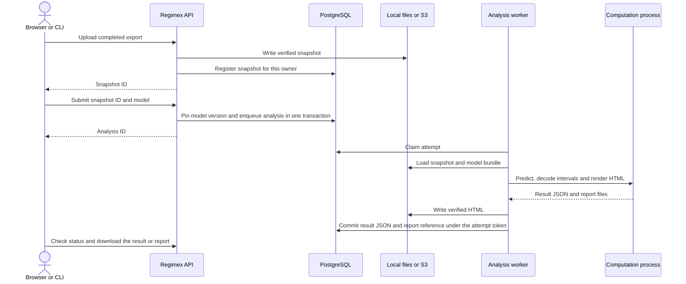

# Architecture

Regimex accepts a snapshot of a completed market experiment. The API serves the
browser and accepts the same exports from a simulator backend. PostgreSQL stores
ownership, job state and analysis results. Immutable object storage holds the
exports, model files and HTML reports.

## From upload to report



The browser and CLI upload the snapshot and request an analysis in two calls.
A simulator backend can do both in one request to
`POST /api/v1/integration/analysis-intake`. The service saves the snapshot
first, so it can be reused if analysis submission fails. Both paths enqueue
the same worker task. [Simulator request sequence](integration.md#request-sequence)

The worker renews its claim while downloading inputs, computing and saving the
report. A retry gets a new attempt token. The database checks the token and
cancellation state in the transaction that makes a result visible. If
cancellation wins, the job ends as cancelled and the report stays unpublished.

## Where to find the code

Paths below are relative to `src/regimex/`.

| Area | Code | Responsibility |
| --- | --- | --- |
| Browser | `web/` | Analysis, model training and integration connection management |
| HTTP | `api.py`, `auth_api.py`, `admin_api.py`, `benchmark_api.py`, `integration_api.py`, `deletion_api.py` | Authenticate requests, validate inputs and call application workflows |
| Workflows | `application/` | Check access, manage snapshots and jobs, train and publish model versions |
| Persistence | `infrastructure/` | Database transactions, migrations, queue and object storage |
| Workers | `service_worker.py`, `computation_worker.py` | Claim tasks, supervise child processes and recover unfinished work |
| Scientific code | `model_registry.py`, `backends/`, `directions.py`, `segmentation.py`, `evaluation.py` | Restore models, prepare features, decode predictions and measure quality |
| Inputs and artifacts | `exports.py`, `data_catalog.py`, `model_bundles.py` | Validate exports, dataset membership and saved model bundles |
| Generator | `market.py`, `market_sampling.py`, `market_export.py` | Simulate a sampled market and build the same export format for the CLI and generated datasets |
| Service reports | `application/report.py`, `application/analysis_comparison.py`, `templates/` | Render a single analysis or compare two completed analyses of the same saved snapshot |
| Report directories | `visualization.py`, `comparison.py` | Render saved predictions across experiments or compare model evaluations |

## Why the components are separate

**Queues and storage.** Procrastinate uses PostgreSQL, so accepting a job and
enqueuing it succeeds or rolls back in one transaction. Analysis, administrative
work and maintenance have separate queues. An administrator can train a model
without occupying an analysis worker. Files can be written before a transaction
commits. Downloads therefore check the database record for ownership and
publication. On deletion, the database removes access first. Storage usage
drops after cleanup succeeds.

**Models and workers.** Each backend receives the original observations, timing
and units. It restores its own weights and preprocessing. The analysis worker's
child process turns the backend's per-step probabilities into intervals using
the decoder settings from that model's bundle. The analysis result records the
settings and the pinned model version. Changing the active model affects future
submissions that select it. To publish a trained candidate, the administrator
must supply a completed validation evaluation for the same weights and
inference policy.

During training, the child writes measured scores and losses to a file in its
attempt directory. The worker sends new rows to PostgreSQL in batches, checking
the attempt token before each write. The browser fetches rows after its last
cursor. Retrying a fit starts a new curve. On success, the worker commits the
metrics from the verified bundle in the same transaction as the model and the
completed run. The browser reads this result from PostgreSQL, so charts remain
available if the owner later deletes the candidate's weights.

**Simulator integration.** The simulator backend checks access to the run,
assembles its observations and holds the integration credential. Regimex checks
the delegated identity and owns the analysis, model and report. A client that
displays the chart alongside a saved result must match both to the same
snapshot. This lets each service keep its own database and release cycle.
See the [integration contract](integration.md).

**Offline reports.** The browser workspace reads jobs and history from the API.
A downloaded HTML report carries the observations, predictions and plotting
code it needs. The in-app preview can reuse a cached copy of Plotly when its
bytes match the version embedded in the report. The CLI can also build a report
directory from matching exports and saved results. See [using reports](usage.md#read-a-report).

## Scaling Regimex

The API accepts and serves work. Analysis workers claim jobs from the same
PostgreSQL queue, and each runs one bounded computation at a time. Training and
maintenance have their own workers. These process boundaries let an operator
add analysis capacity independently and keep model imports out of the web
process. PostgreSQL also commits the intake record and queue delivery together.
A separate message broker would require another mechanism for that guarantee.

### Add capacity on one host

For an existing installation, set the desired worker count and resources in the
project's `.env`. Run Compose from the deployment directory with the same project
name and files used at startup. For [S3 storage](deployment.md#s3-profile),
keep `COMPOSE_FILE=compose.yaml:compose.s3.yaml` in the environment.

```sh
docker compose --profile service up -d --wait --no-deps analysis-worker
```

Each replica has a separate work directory, model cache and health identity.
All replicas share the job queue and the configured object store.

| Setting | Default | Effect |
| --- | --- | --- |
| `REGIMEX_ANALYSIS_REPLICAS` | 1 | Number of analysis worker containers |
| `REGIMEX_ANALYSIS_WORKER_CPUS` | 2 | CPU quota per replica, fractional values allowed |
| `REGIMEX_ANALYSIS_CPUSET` | All CPUs available to the container | Optional CPU IDs, for example `2-3`, for the workers and their computation children |
| `REGIMEX_ANALYSIS_WORKER_MEMORY` | 8g | Container memory limit per replica, including its cache, scratch and child |

When running from source, additional worker processes need distinct
`REGIMEX_WORK_ROOT` values. Use the same database, object store and storage
limits. Stop all replicas before [offline maintenance](storage.md#stop-writers-before-maintenance).

Compare completed analyses per minute, queue delay, worker occupancy and peak
memory while varying replica count. For a comparison at constant resources,
keep the combined worker CPU and memory budgets fixed. For an expansion, leave
headroom for PostgreSQL, the API and administrative work. The model's thread
count is set on registration. More threads and more workers can compete for the
same CPUs.

If upload or polling latency rises while workers have spare capacity, measure
the API and database separately. Each API process admits up to
`REGIMEX_HTTP_CONCURRENCY_LIMIT` active requests. A request holds its slot
until the response finishes. Static assets and the liveness probe bypass
this limit. A `503 capacity_limit` with `Retry-After` means all slots are busy.
Before raising the limit, check memory use and database connections under load.
If Uvicorn logs `Exceeded concurrency limit`, it has reached the separate
`REGIMEX_HTTP_CONNECTION_LIMIT`, which also counts idle keep-alive sockets.
When a submission returns `429 capacity_limit` because the queue
quota is full, wait for an outstanding job to finish. Both analysis and admin
intake count the owner's queued, running and cancellation-requested operations.
By default, analysis intake refuses new work at eight outstanding operations
and admin intake at four. An integration also has a limit of 32 outstanding
analyses across its users. See [request and queue limits](access.md#request-and-queue-limits).

Analysis jobs share a priority. A free worker claims the ready, unlocked
delivery with the lowest job ID. An owner with room in their quota can still
wait behind another owner's backlog.
Two workers can serve the same owner when that owner is the only one waiting.

The load stand uses one owner. To compare scheduling policies, fill one
owner's queue with long analyses and submit a short analysis from a second
owner. Count the waiting jobs that start before the short analysis, then swap
the owners. Also test an older queued job while other owners submit one job
at a time. A priority fixed from the owner's backlog at submission lets each
new arrival overtake that older job. Measure both owners' queue delays and
total completed analyses before changing the scheduling policy.

The supplied Compose API publishes one host port. Multiple API replicas would
need a shared HTTPS entry point that preserves the configured origin and
authentication checks.

### Accelerators and multiple hosts

All three packaged backends run on the CPU. The adaptive forest uses NumPy
for inference, the baseline uses CPU numerical libraries and the TCN uses the
CPU build of PyTorch. Device selection forms part of the immutable inference policy.
Operators can pin the device, thread count and batch limit when
[registering a model](models.md#saved-models). The packaged workers validate
CPU execution and reject a CUDA request.
Before adding a GPU worker, measure the part of worker time spent in model
prediction. Model restoration, report generation and storage also contribute
to latency.

A GPU deployment would need a separately tested worker image, a device-specific
queue chosen with the model at intake, and capability checks on the workers
that consume it. Keep the API machine independent of accelerator availability.
Bind the selected runtime to the accepted job, enforce device memory limits
and verify probabilities and decoded intervals against the CPU reference on
real hardware. A dedicated inference service becomes worth evaluating when
keeping models resident or batching requests across users saves enough time
to cover the extra transfer and scheduling cost.

The current storage contract limits writers to a single host. The local
backend uses filesystem locks, and S3 writers also share a local coordination
directory for capacity checks and deletion. To put writers on multiple hosts,
first replace this coordination with shared, fenced reservations and test
worker loss during writes, cleanup and restore. See [storage guarantees](storage.md).

### Planning for more users

Size a deployment by accepted analyses per minute, input length and simultaneous
uploads. Browser sessions also produce status reads. Measure time waiting for a
worker separately from worker occupancy and HTTP latency. Three historical
single-host runs used one owner, two workers, already uploaded 512-step inputs
and `tcn-0.2.0`. The entire stand shared a two-CPU, 3 GiB resource budget.
The timer ends when the result download returns. The client then verifies it.
[Fixed-arrival workload](load-testing.md#workloads)

| Scheduled analyses/min | Arrival window | Verified / scheduled | Refused at owner quota | Median queue wait | p95 submission to download |
| ---: | ---: | ---: | ---: | ---: | ---: |
| 12 | 90 s | 18 / 18 | 0 | 0.03 s | 6.56 s |
| 24 | 90 s | 36 / 36 | 0 | 2.16 s | 12.33 s |
| 24 | 240 s | 75 / 96 | 21 | 16.15 s | 34.58 s |

In the longest run the median model load took 2.63 s and the backend prediction
took 0.20 s. The runs used different revisions. Repeat them with the intended
model, users and traffic mix before sizing a deployment.
[Timing definitions](analysis-timings.md)

1. **Scale workers on the current host.** Compare worker counts at a fixed CPU
   and memory budget. Track queue age, refusals, completions and p95 latency,
   including requests from a second owner while the first has long jobs queued.
   If model restoration still dominates worker time, benchmark keeping a verified
   model resident across jobs with the same model digest and runtime policy.
   Test cancellation, per-job resource limits and isolation between users
   against the current one-process-per-job implementation.
2. **Make S3 writes safe across hosts.** PostgreSQL already tracks owner and
   integration quotas. A design to test is a reservation for total bytes and
   inventory entries across the storage prefix. Give every upload a write token,
   including snapshot uploads and model imports. Reserve before uploading,
   record the verified provider version and check the token on publication.
   Jobs also check their current attempt. Reconcile abandoned uploads, retained
   versions and delete markers before releasing capacity. Exercise two hosts
   racing for the last free bytes, a lost connection after upload, a late worker,
   a download concurrent with cleanup, and offline restore. Verify capacity and
   that each accepted analysis publishes at most one result.
3. **Replicate the API and workers independently.** Once storage passes those
   checks, use one public origin behind a TCP pass-through load balancer, shared
   PostgreSQL and object storage, and private scratch space and caches per
   worker. Exercise login, upload, polling, cancellation and download across
   different API replicas. Include host loss during an analysis. Budget database
   connections across all replicas. The repository currently opens a connection
   per context. If connection setup becomes a bottleneck, benchmark a bounded
   pool while preserving restore readiness checks and worker heartbeats.
   Test PostgreSQL failover by interrupting a submission near commit.
   Retry its idempotency key and verify that exactly one operation and its
   result survive. Include worker reconnection and lease renewal in that drill.

Keep JSON for the public simulator and browser contracts. The snapshot digest
binds its validated contents using the project's [export encoding](integration.md#export-contract).
An offline size comparison used four two-instrument exports at each length.
The prototype kept the metadata in JSON and encoded observation rows as typed
Protobuf messages with optional numeric fields, enum states and instrument
indices. Both readers reconstructed identical JSON values and numeric types
for all eight exports. Sizes below are summed bytes with gzip level 6.

| Steps per instrument | JSON | JSON + gzip | Prototype | Prototype + gzip |
| ---: | ---: | ---: | ---: | ---: |
| 512 | 1,196,480 | 93,757 | 290,036 | 79,342 |
| 4,096 | 9,555,637 | 570,734 | 2,297,222 | 456,804 |

The API and integration client currently require uncompressed bodies. If
bandwidth becomes a constraint, prototype bounded compression first. The binary
prototype saved another 20% on the compressed 4,096-step files. Median CPU time
to decompress and produce a digest-verified export was 318 ms for JSON and
342 ms for the Python Protobuf adapter on these files (three timed reads per
file). Measure peak memory and end-to-end latency with realistic traffic.
Enforce the decoded size limit during decompression.

If parsing the observation rows still dominates, compare a typed Protobuf
message with compressed JSON for transport, or Arrow for repeated column scans
during training. Preserve missing values, observed zeros, decimal precision
and the original grid. Verify that both readers reconstruct the same export
digest and intervals before adding an encoding to the simulator adapter.
Deterministic Protobuf output alone does not define a canonical content hash.
[Protobuf serialization](https://protobuf.dev/programming-guides/serialization-not-canonical/) ·
[Arrow columnar layout](https://arrow.apache.org/docs/format/Columnar.html)
