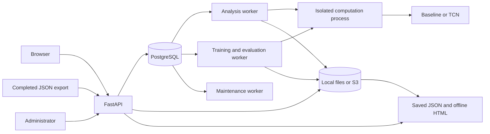
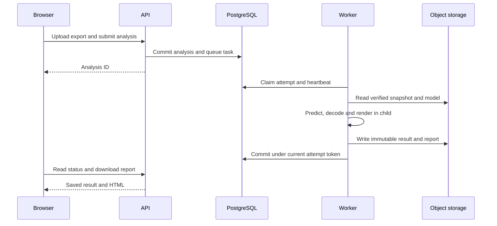

# Architecture

Regimex is a Python application with an HTTP API, a small browser interface and
separate workers. It analyzes completed experiments; it does not participate in
trading or read a simulator's database.

## What happens when a user selects Analyze

1. The API validates the completed export, checks the user's access and stores an
   immutable snapshot. The export preserves its original time grid and missing values.
2. Submission resolves `active` to a particular model version and inference
   policy. PostgreSQL commits the analysis record and queue task together.
3. The analysis worker claims an attempt. Its child process restores the model
   and preprocessing, builds that backend's features and predicts three class
   probabilities for every original observation.
4. A shared decoder turns probabilities into direction intervals. Availability
   and interval statistics come from observations. The child builds the HTML report.
5. The parent verifies identities and hashes, uploads the objects and commits
   the result only if the attempt is still current and uncancelled.
6. The browser reads the saved result. Downloaded HTML works without the service.

## Where to find the code

| Area | Responsibility |
| --- | --- |
| `src/regimex/web/` | Browser form, history, progress and result preview |
| `api.py`, `auth_api.py`, `admin_api.py`, `benchmark_api.py` | HTTP validation, authentication and typed routes |
| `application/` | Resource identity, permissions, workflows and commits |
| `infrastructure/` | PostgreSQL repositories, migrations and local/S3 adapters |
| `service_worker.py`, `computation_worker.py` | Queue execution, isolated children, recovery and resource limits |
| `model_registry.py`, `model_contracts.py`, `backends/` | Installed backend discovery and training/prediction contracts |
| `baseline.py`, `temporal.py`, `features.py` | Numeric model implementations and feature preparation |
| `market.py`, `market_sampling.py` | Order-driven simulation and parameter sampling |
| `directions.py`, `segmentation.py`, `evaluation.py` | Automatic references, decoding and evaluation |
| `exports.py`, `data_catalog.py`, `model_bundles.py` | Versioned inputs, datasets and model artifacts |
| `templates/`, `visualization.py`, `comparison.py` | Offline reports |

## Why these choices

| Decision | Reason and tradeoff |
| --- | --- |
| One application, separate processes | Shared contracts stay easy to change while training cannot occupy the interactive analysis queue. Deployment needs several processes, not several independently versioned services. |
| FastAPI and Pydantic | Request schemas, validation and OpenAPI come from the same typed contracts. Scientific calculations remain outside route handlers. |
| PostgreSQL and Procrastinate | Jobs and application state share a real transaction. There is no second broker whose publication must be coordinated with the database. |
| Immutable objects outside PostgreSQL | Large observations, weights and reports do not inflate relational rows. PostgreSQL still decides ownership and visibility; an uploaded file alone is not a published result. |
| Explicit model publication | Training creates a candidate. Evaluation and activation are separate, so a successful fit cannot unexpectedly replace the model used by users. |
| Isolated computation children | Torch/BLAS settings, time, address-space and scratch limits apply per computation. Cancellation and worker death cannot leave an unfenced result commit. This runs trusted installed code, not uploaded Python. |
| Backend-owned features | Logistic regression and TCN receive the same raw observations but can prepare different inputs. Adding an architecture does not require adding branches to HTTP handlers. |
| Logistic baseline and TCN | A small aggregate model provides a control; TCN can represent local and longer temporal shape. Both use the same splits, decoder and evaluation policy. |
| A shared interval decoder | Full coverage and minimum duration have one meaning across models. A high pointwise classification score alone cannot justify fragmented intervals. |
| Plain browser JavaScript and packaged Plotly | The interface has a small deployment surface, and exported reports retain their controls offline. It does not need a frontend build service or CDN. |
| PostgreSQL `json` for digest-bound numbers | Signed zero and exponent-form numbers survive database and backup round trips. Metadata that does not require faithful numeric representation can use `jsonb`. |

## Boundaries that matter

Backends receive observations, timing, units and missingness. Labels, reference
boundaries, generator settings and seeds are absent from prediction inputs.
Installed descriptors are lightweight; each worker separately checks its actual
dependencies, device and artifact codec. Unsupported settings fail explicitly.

Repeated job delivery is expected. Attempt tokens and heartbeats prevent stale
workers from publishing. Idempotency keys are scoped to the authenticated owner
and operation. Source and run checks also apply to integrations and downloads.

The S3 profile currently uses one host with a shared coordination directory.
Container deployment and operational limits are described in
[deployment](deployment.md); backup and restoration are in [storage](storage.md).
The [model reference](models.md) explains the scientific choices in detail.
