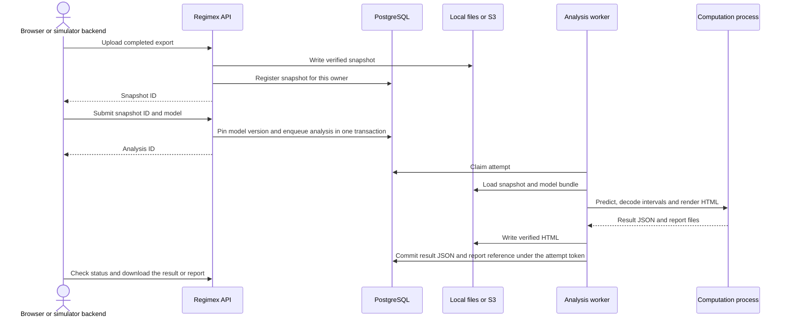

# Architecture

Regimex accepts a snapshot of a completed market experiment. The API serves the
browser and accepts the same exports from a simulator backend. PostgreSQL stores
ownership, job state and analysis results. Immutable object storage holds the
exports, model files and HTML reports.

## From upload to report

The worker renews its claim while downloading inputs, computing and saving the
report. A retry gets a new attempt token. The database checks the token and
cancellation state in the transaction that makes a result visible. If
cancellation wins, the job ends as cancelled and the report stays unpublished.

## Where to find the code

Paths below are relative to `src/regimex/`.

| Area | Code | Responsibility |
| --- | --- | --- |
| Browser | `web/` | Sign-in, upload, history, report preview and comparisons |
| HTTP | `api.py`, `auth_api.py`, `admin_api.py`, `benchmark_api.py` | Validate requests and call the application as the authenticated principal |
| Workflows | `application/` | Check access, manage snapshots and jobs, train and publish model versions |
| Persistence | `infrastructure/` | Database transactions, migrations, queue and object storage |
| Workers | `service_worker.py`, `computation_worker.py` | Claim tasks, supervise child processes and recover unfinished work |
| Scientific code | `model_registry.py`, `backends/`, `directions.py`, `segmentation.py`, `evaluation.py` | Restore models, prepare features, decode predictions and measure quality |
| Inputs and artifacts | `exports.py`, `data_catalog.py`, `model_bundles.py` | Validate exports, dataset membership and saved model bundles |
| Generator | `market.py`, `market_sampling.py` | Simulate orders and executions and sample experiment settings |
| Reports | `templates/`, `visualization.py`, `comparison.py` | Render results and comparisons with scripts that work offline |
| Local installation | `local_installation/` | Install the service, coordinate updates and verify backups |

## Why the components are separate

**Queues and storage.** Procrastinate uses PostgreSQL, so accepting a job and
enqueuing it succeeds or rolls back in one transaction. Analysis, administrative
work and maintenance have separate queues. An administrator can train a model
without occupying an analysis worker. Files can be written before a transaction
commits. Downloads therefore check the database record for ownership and
publication. On deletion, the database removes access first. Storage usage
drops after cleanup succeeds.

**Models and workers.** Each backend receives the original observations, timing
and units. It restores its own weights and preprocessing. All backends use the
same decoder and interval metric, so results from different models are
comparable on the same snapshot. Model code runs in a child process with its
own time, memory and thread limits. An administrator can evaluate a trained
candidate before publishing it. Each accepted analysis keeps its selected model
version even if the active model changes.

**Simulator integration.** The simulator backend checks access to the run,
assembles its observations and holds the integration credential. Regimex checks
the delegated identity and owns the analysis, model and report. A client that
displays the chart alongside a saved result must match both to the same
snapshot. This lets each service keep its own database and release cycle.
See the [integration contract](integration.md).

**Offline reports.** The browser workspace reads jobs and history from the API.
A downloaded HTML report carries the observations, predictions and plotting
code it needs. The CLI can also build a report directory from matching exports
and saved results. See [using reports](usage.md#read-a-report).
