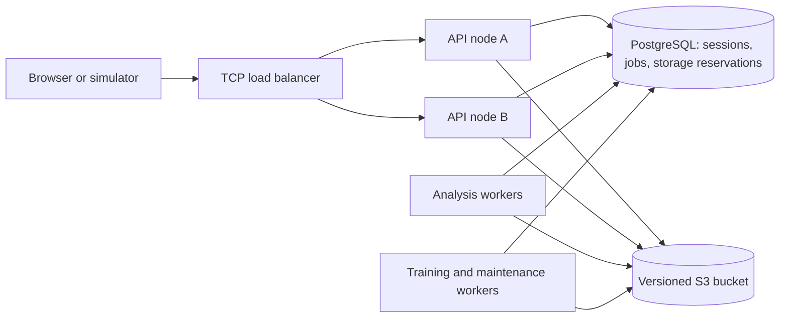

# Deploy on multiple application nodes

Use this topology when one host has reached its worker or API capacity.
Each node runs only its assigned roles. All nodes use the same PostgreSQL
database and schema, private versioned S3 prefix, release and public HTTPS
origin. The supplied Compose files configure the application nodes. Provision
the database, bucket, DNS and load balancer separately.



## Prepare the nodes

1. Provision PostgreSQL 16 with a dedicated application database and role.
   Connect directly or use a session-mode pooler so storage operations retain
   their advisory locks. Use the same schema on every node. The versioned store must support the
   [S3 guarantees](storage.md#s3-storage). SeaweedFS 4.48 over HTTPS is tested.
2. On every node, install the same Regimex release and configure Compose
   2.24.4 or later. Use one image tag across the installation. Build only
   the images needed on each node, or load the corresponding prebuilt images.
3. Put the application DSN in a private `database-dsn` file owned by container
   UID 10001. Use the database's certificate hostname and `sslmode=verify-full`.
   Install its trusted root as `database-ca.crt`. Supply the S3 credential
   profile and provider CA from the [S3 deployment guide](deployment.md#s3-profile).
   API nodes also need a certificate and private key for the public DNS name
   and an `api-ca.crt` for the readiness probe.
4. On each node, put the following nonsecret settings in the deployment's
   `.env` or export them in the shell. Replace the example hostnames, prefix,
   release tag and paths. Set `REGIMEX_BIND_ADDRESS` to the API node's private
   interface address. Permit its HTTPS port from the load balancer.

```dotenv
COMPOSE_FILE=compose.yaml:compose.s3.yaml:compose.cluster.yaml
REGIMEX_IMAGE_TAG=release-1
REGIMEX_SECRETS_DIR=/etc/regimex/secrets
REGIMEX_PUBLIC_ORIGIN=https://regimex.example.org
REGIMEX_BIND_ADDRESS=10.0.1.10
REGIMEX_HTTPS_PORT=8443
REGIMEX_S3_ENDPOINT_URL=https://objects.example.org
REGIMEX_S3_BUCKET=regimex
REGIMEX_S3_PREFIX=production
```

The overlay selects PostgreSQL coordination for S3. An individual node can
have its own staging volume, scratch directory and model cache. Existing
single-host S3 installations must stop **all** writers before switching
coordination modes. The overlay mounts a fresh node-local staging volume.
Leave the previous coordination volume with the stopped installation. Keep the
same bucket, prefix, database, limits and service identity.
Follow the [upgrade procedure](deployment.md#upgrade-an-existing-deployment)
for backups and migrations. Moving from local objects requires a
[coordinated restore](storage.md#backup-and-restore).

## Start the assigned roles

Run the migration once against the shared database. The overlay uses an
external database and starts each role independently.

```sh
docker compose --profile ops config --quiet
docker compose build migrate ops
docker compose run --rm migrate
docker compose run --rm ops service storage-check
```

On **each API node**, start the API. On a **compute node**, set its worker
count according to its CPU and memory budget. Before starting a role, verify
that the credentials, certificate and prefix on its node reach the versioned
store. Substitute the local service name for `api` on worker hosts.

```sh
docker compose --profile '*' run --build --rm --no-deps api service storage-check
```

Run the following commands on the nodes assigned those roles.

```sh
docker compose --profile api up --build -d --wait
REGIMEX_ANALYSIS_REPLICAS=2 docker compose --profile analysis up --build -d --wait
docker compose --profile training up --build -d --wait
docker compose --profile maintenance up --build -d --wait
```

Keep at least one maintenance worker running for abandoned jobs and cleanup.
The training worker handles administrative training jobs. Add analysis workers
without restarting either role. The existing [operator commands](deployment.md#start-the-service)
create tokens and register the first published model. Run them on a designated
ops node and keep its token output volume private.

## Route and verify traffic

Terminate TLS at the Regimex API. Configure the load balancer for TCP
pass-through with an HTTPS `GET /health/ready` probe on each backend. Probe
using the public hostname for TLS verification and the HTTP Host header. A
ready backend returns 200 when the database accepts writes, the schema is
current and any restore has finished. Browser sessions live in PostgreSQL, so clients
can use any ready replica. Preserve the public origin across every request.

The [HAProxy example](../deploy/haproxy.cfg.example) routes to two private
API addresses. Substitute your public hostname, both backend names and ports,
trusted API CA path and public listener port. HAProxy uses the nameservers
in its `/etc/resolv.conf` to track changes to backend addresses.
The example listens on 8443;
a deployment advertising default HTTPS must expose it on 443 or change the
listener to 443. Set the probe Host header to include the public port for a
nondefault port.

On a dedicated test deployment, verify the same login, upload, replayed
submission and download through two different nodes. The probe creates a
saved snapshot and analysis under the test account, verifies both copies
of the report, cancels a second job across replicas and signs out.
Set the shell variables to the public origin,
two private HTTPS addresses (including ports), trusted CA and test token.

```sh
uv run --locked --extra service python tests/support/cluster_smoke.py \
  --origin "$REGIMEX_PUBLIC_ORIGIN" --nodes "$API_A" "$API_B" \
  --ca-file "$API_CA" --token-file "$TEST_TOKEN" --export tests/fixtures/experiment-v2.json
```

For a rollout, drain one API node from the balancer, update it, wait for
readiness and return it before updating its peer. Coordinate schema migrations
and [offline maintenance](storage.md#stop-writers-before-maintenance) across
**all nodes**. Keep an inventory of API, worker and operator entry points.

## Capacity and failover

Use the [load tests](load-testing.md) against the common ingress. Track
per-owner queue delay, refused and completed arrivals, worker occupancy, p95
latency and database connections. Add workers for a growing analysis backlog
and API capacity for HTTP admission pressure. Set connection budgets across
the installation, including health checks and background workers.

Exercise the loss of one API after a submission, then retry its idempotency key
through the other. Stop a worker during a long job and check the single result
after recovery. For a database promotion, fence the former primary and preserve
all acknowledged commits, including outstanding upload reservations. A standby
that can lose committed transactions requires offline reconciliation with the
S3 version inventory before writers resume. Test the specific database and
object-store failover arrangements your installation uses.

### What was exercised

Two isolated Compose projects on one Docker Engine shared a private versioned
SeaweedFS bucket and PostgreSQL 16. HAProxy routed HTTPS to both API nodes.
The replica probe signed in on one node, used the same session on the other,
replayed a submission, compared the JSON and HTML from both nodes, cancelled
a second analysis and verified that signing out revoked the session on both.

| Induced failure | Observed result |
| --- | --- |
| Stopped the first API and killed its worker during a 4,096-step analysis | The second node accepted the same idempotency key. Its worker completed attempt two. There was one operation, one analysis and one published report, 54 s after the interruption. |
| Connected an API to a synchronous, read-only PostgreSQL standby | Liveness returned HTTP 200 and readiness returned 503. |
| Fenced the primary while a new submission was waiting to commit, then promoted the standby | Retrying the key produced one completed analysis and one report in 25 s from interruption. Replaying an earlier acknowledged key returned its original ID. Its JSON result and stored HTML matched their original SHA-256 digests. |

The timings include job processing. The worker drill used a 15-second stale
attempt threshold, and the database drill used a manual promotion. Use your
own hosts, network, provider and configured timeouts to measure recovery time.
