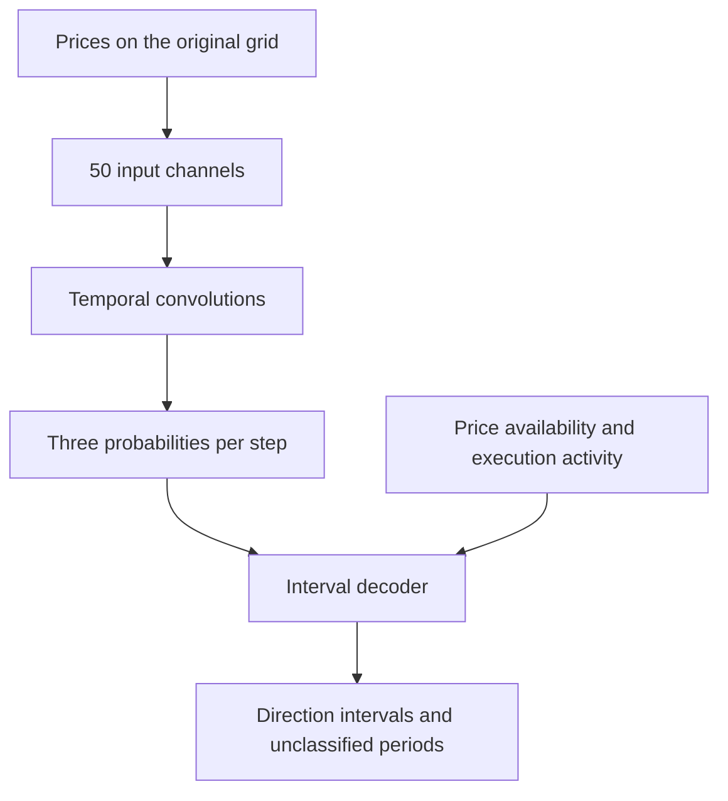

# Temporal convolutional network

The TCN reads the price history of one instrument in a completed experiment.
At each step it estimates probabilities for sideways movement, growth and
decline. The network can use later observations to classify an earlier step.
This makes it suitable for describing a finished run.

## What the network sees

For every step the backend builds 25 numeric features and a missing-value
indicator for each one.

| Inputs | How they are calculated |
| --- | --- |
| Price and return (3) | Log price relative to the first available price, one-step log return and its absolute value. A missing endpoint makes the return missing. |
| Whole-instrument context (2) | The current log price standardized using the instrument's observed log prices, and a feature measuring their spread. |
| Centered windows (20) | At each of 32, 64, 128, 256 and 512 steps, measure the fitted change in log price, the quality of the straight-line fit, the change between observed endpoints and the fraction of steps with a price. |

The feature builder compresses large log-price changes and returns with scaled
inverse hyperbolic sine transforms. Windows stop at the instrument boundaries.
Within a window, the fit uses observed prices at their original step numbers.
Two equal endpoint prices give a zero change. A single price leaves that
feature missing and still contributes to coverage. The backend fills missing numeric features
with training medians (zero for a feature absent throughout training) and
standardizes them with saved training statistics. The 25 indicators remain
binary. [Feature construction and preprocessing](../src/regimex/temporal.py)

## From features to intervals

A pointwise convolution mixes the 50 input channels at each step. A stack of
residual blocks then combines information across steps. In a block with
dilation `d`, the width-three convolution reads positions `t − d`, `t`
and `t + d`. The block applies ReLU, mixes the channels with a pointwise
convolution, applies dropout during training and adds the result to its
input. When batching instruments of different lengths, the network masks
padding after the input projection and after every block.

The default eight dilations double from 1 to 128. Together the convolutions
can read 255 **feature rows** on each side of a step. The underlying price
history can reach further because each row already contains centered-window
and whole-instrument statistics.

A final pointwise convolution and softmax give three probabilities on every
original step. The shared decoder chooses a sequence of intervals that balances
those probabilities against the cost of switching direction, subject to
minimum duration and price coverage. For example, a brief peak in growth
probability can fall inside a longer sideways interval. Trading activity can
affect whether the decoder assigns a direction even when the price inputs to
the network stay the same. [Interval and availability rules](models.md#observations-and-intervals)

## Training and the published model

Training uses AdamW and class-balanced cross-entropy on steps with known
training directions. The four steps on either side of a training direction
change receive double weight within the same available block. An optional
weight gives shorter reference intervals more influence. The smoothing
term penalizes changes in log probabilities between adjacent steps with
the same known direction.

The default training configuration uses 32 hidden channels and epoch-based
early stopping. A fixed-update run evaluates the requested checkpoints and
counts only batches with known targets toward its update budget. Both
modes select the checkpoint by decoded validation interval macro-F1.
[Training request and checkpoint example](api.md#3-train-and-publish)

The published `tcn-0.2.0` uses 48 hidden channels and the eight dilations
above. Validation selected update 900 with seed 29. Its saved preprocessing,
weights and `direction-32/2.0` profile determine its predictions. For the
measured interval accuracy and the effect of allowing a transition a few
steps early or late, see the [reference model evaluation](quality.md#reference-model-on-direction-3220).
