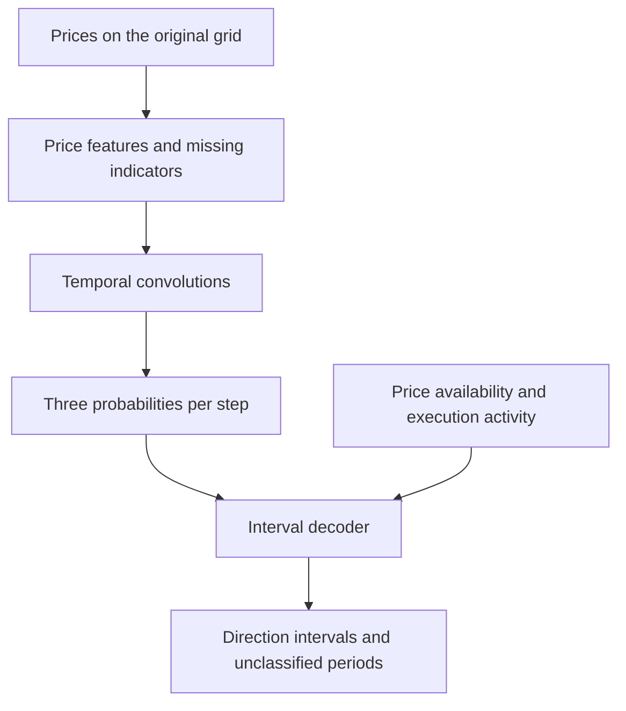

# Temporal convolutional network

The TCN reads the price history of one instrument in a completed experiment.
At each step it estimates probabilities for sideways movement, growth and
decline. The network can use later observations to classify an earlier step.
This makes it suitable for describing a finished run.

## What the network sees

By default the backend builds 25 numeric features per step and a missing-value
indicator for each one.

| Inputs | How they are calculated |
| --- | --- |
| Price and return (3) | Log price relative to the first available price, one-step log return and its absolute value. A missing endpoint makes the return missing. |
| Whole-instrument context (2) | The current log price standardized using the instrument's observed log prices, and a feature measuring their spread. |
| Centered windows (20) | At each of 32, 64, 128, 256 and 512 steps, measure the fitted change in log price, the quality of the straight-line fit, the change between observed endpoints and the fraction of steps with a price. |

The feature builder compresses large log-price changes and returns with scaled
inverse hyperbolic sine transforms. Windows stop at the instrument boundaries.
Within a window, the fit uses observed prices at their original step numbers.
Two equal endpoint prices give a zero change. A single price leaves that
feature missing and still contributes to coverage. The backend fills missing numeric features
with training medians (zero for a feature absent throughout training) and
standardizes them with saved training statistics. The 25 indicators remain
binary. [Feature construction and preprocessing](../src/regimex/temporal.py)

A TCN training request can set `parameters.side_slopes` to `true` to add four
features. At each step the backend fits log-price slopes independently across
the preceding 16 and 32 steps and the following 16 and 32 steps. Each window
includes the current step. The four fits and their missing-value indicators
bring the input width to 58. The package records the layout so inference
rebuilds the features used in training. In a comparison on new simulations,
this option recovered fewer short sideways intervals. [Measured results](evaluations/interval-errors.md#past-and-future-price-slopes)

A separate offline comparison tested a flat center window between two sloping
flanks, both as a learned input and as a check on a decoded trend.
[Short-pause comparison](evaluations/pause-supervision.md#using-slope-contrasts-to-find-a-pause)

## From features to intervals



A pointwise convolution mixes the input channels at each step. A stack of
residual blocks then combines information across steps. In a block with
dilation `d`, the width-three convolution reads positions `t − d`, `t`
and `t + d`. The block applies ReLU, mixes the channels with a pointwise
convolution, applies dropout during training and adds the result to its
input. When batching instruments of different lengths, the network masks
padding after the input projection and after every block.

The default eight dilations double from 1 to 128. Together the convolutions
can read 255 **feature rows** on each side of a step. The underlying price
history can reach further because each row already contains centered-window
and whole-instrument statistics.

With 50 inputs, eight blocks and three output classes, a network with
`h` hidden channels learns `32h² + 70h + 3` weights and biases. Each block
has a width-three convolution and a pointwise convolution, both connecting
all hidden channels. Doubling the width therefore costs nearly four times
as many parameters. Changing the dilation distances alone preserves the
parameter count.

A final pointwise convolution and softmax give three probabilities on every
original step. The shared decoder chooses a sequence of intervals that balances
those probabilities against the cost of switching direction, subject to
minimum duration and price coverage. For example, a brief peak in growth
probability can fall inside a longer sideways interval. Trading activity can
affect whether the decoder assigns a direction even when the price inputs to
the network stay the same. [Interval and availability rules](models.md#observations-and-intervals)

## Training and saved versions

Training uses AdamW and class-balanced cross-entropy on steps with known
training directions. The four steps on either side of a training direction
change receive double weight within the same available block. An optional
weight gives shorter reference intervals more influence. The smoothing
term penalizes changes in log probabilities between adjacent steps with
the same known direction.

The default TCN has 32 hidden channels. The epoch policy fits three initializations
(seeds 11, 23 and 47) to sample variation between fits. Each gets up to 30
epochs, using batches of 16 and a learning rate of 0.001. Validation runs at
the first and last epoch and every two epochs in between. Five consecutive
checks without improvement stop that repeat, limiting time spent on a plateau.
Fixed-update runs check the requested
updates and count only batches with known targets. Both training modes retain
the checkpoint with the highest decoded validation interval macro-F1.
[Training request and checkpoint example](api.md#3-train-and-publish)

Both published versions use 48 hidden channels, the eight dilations above
and the `direction-32/2.0` profile. Each has its own fitted weights and
preprocessing. The `model_version_id` in the bundle's `manifest.json` tells
you which one you have.

| Model version | Selected training checkpoint |
| --- | --- |
| `tcn-0.1.0` | Epoch 1, seed 11 |
| `tcn-0.2.0` | Optimizer update 900, seed 29 |

The [direction classifier comparison](direction-context.md#results) evaluates
both versions on the same 144 experiments. The [reference model evaluation](evaluations/reference-releases.md#reference-model-on-direction-3220)
gives the original 384-experiment benchmark and boundary scores for `tcn-0.2.0`.

## Comparing model widths

Four TCN widths were fitted to 96 synthetic training experiments with 147
instrument series. Validation used 30 separate experiments with 42 series.
Both partitions contained equal numbers of 256-step and 512-step experiments.
The generator assigned complete seed groups to partitions before simulation.
Automatic references and decoding used the service profile `direction-32/2.2`.

Every width used the same features, dilations, optimizer settings and batch
size of eight sequences. Each training seed received 96 optimizer updates.
The table shows the best decoded validation interval macro-F1 at updates
32, 64 or 96 for each seed. The mean gives each of the three repeats equal
weight.

| Hidden channels | Trainable parameters | Seed 11 | Seed 23 | Seed 47 | Mean |
| ---: | ---: | ---: | ---: | ---: | ---: |
| 16 | 9,315 | 0.6938 | 0.6748 | 0.7138 | 0.6941 |
| 32 | 35,011 | 0.7044 | 0.7089 | 0.6862 | 0.6998 |
| 48 | 77,091 | 0.7470 | 0.7274 | 0.7396 | **0.7380** |
| 64 | 135,555 | 0.7253 | 0.7243 | 0.7297 | 0.7264 |

The 48-channel network scored highest for every seed. Its mean exceeded the
32-channel default by 0.0382, at about 2.2 times the parameter count.
Checkpoint selection and scoring used the same 30 experiments, so these
figures describe validation performance under this update budget.

The logistic baseline scored **0.5032** on the same validation partition.
It fitted 867 coefficients and intercepts using L-BFGS. Validation selected
`C = 1` from 0.1, 1 and 10.

### Independent validation

The best checkpoint across the three repeats of each width was frozen before
generating 64 further experiments, 32 at each length. Together they contained
97 instrument series. Each score below belongs to one fitted model. The
comparison above averaged three checkpoint scores per width.

| Frozen model | Selected seed | Selected update | Independent interval macro-F1 |
| --- | ---: | ---: | ---: |
| Logistic baseline | 11 | — | 0.5097 |
| TCN, 16 channels | 47 | 96 | 0.7037 |
| TCN, 32 channels | 23 | 32 | 0.6509 |
| TCN, 48 channels | 11 | 96 | **0.7200** |
| TCN, 64 channels | 47 | 32 | 0.6893 |

The 48-channel model scored highest again. Its advantage over the 32-channel
model was 0.0691. The paired 95% bootstrap interval ranged from −0.0109 to
+0.1544, allowing either model to lead on another sample. The interval uses
2,000 draws of whole experiments with seed 1729 and keeps every instrument
with its experiment. It describes sampling uncertainty for these two frozen
models on this simulator.

To reproduce both comparisons, pass an unused directory to the first command.
It saves the training and validation data, plans, bundles and per-seed
scores. The second command verifies the frozen bundles and evaluates them on
the independent cohort. It checks for overlap with the first corpus before
reading annotations. Pass `--exposure-index PATH` to include additional known
seeds and identity hashes in this check.

```sh
uv run --locked --extra ml python scripts/compare_tcn_widths.py var/tcn-widths
uv run --locked --extra ml python scripts/confirm_tcn_widths.py var/tcn-widths
```
